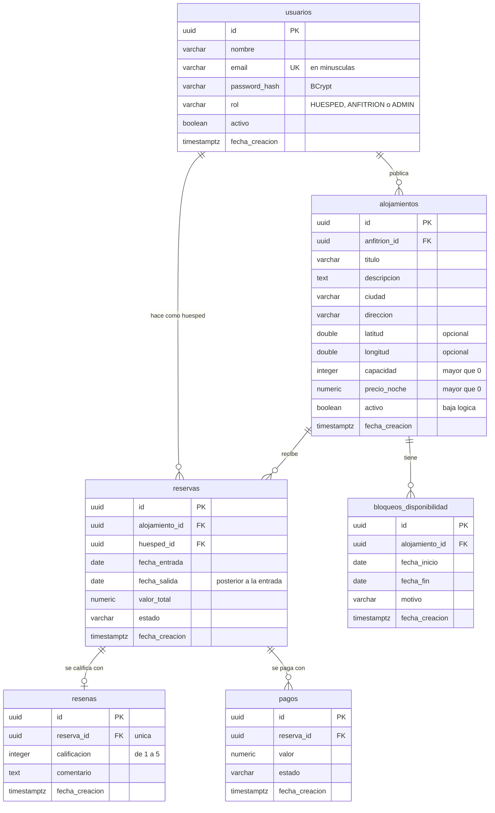

# Diseño de la base de datos

Upland usa PostgreSQL 16 como única fuente de verdad. El esquema se crea con migraciones
de Flyway versionadas en [`backend/src/main/resources/db/migration`](../backend/src/main/resources/db/migration);
Hibernate solo lo valida al arrancar (`ddl-auto: validate`) y nunca lo modifica.

Este documento cubre el modelo completo del proyecto. No todo está construido en la fase 1:

| Tabla | Estado | Migración |
|---|---|---|
| `usuarios` | Implementada | `V1__usuarios_y_alojamientos.sql` |
| `alojamientos` | Implementada | `V1__usuarios_y_alojamientos.sql` |
| `reservas` | Implementada | `V2__reservas.sql` |
| `bloqueos_disponibilidad` | Diseñada, sin implementar | — |
| `resenas` | Diseñada, sin implementar | — |
| `pagos` | Diseñada, sin implementar | — |

## Diagrama entidad-relación



Cómo leer las líneas: `||--o{` es una relación de uno a muchos donde el lado "muchos" es
opcional. Un usuario puede no tener alojamientos o tener varios, pero cada alojamiento
pertenece a exactamente un usuario.

## Relaciones y cardinalidad

| Relación | Cardinalidad | Significado |
|---|---|---|
| `usuarios` → `alojamientos` | 1 a N | Un anfitrión publica cero o más alojamientos. Cada alojamiento tiene un solo anfitrión. |
| `usuarios` → `reservas` | 1 a N | Un usuario hace cero o más reservas como huésped. |
| `alojamientos` → `reservas` | 1 a N | Un alojamiento recibe cero o más reservas. |
| `alojamientos` → `bloqueos_disponibilidad` | 1 a N | Un anfitrión bloquea cero o más rangos de fechas de su alojamiento. |
| `reservas` → `resenas` | 1 a 0..1 | Una reserva tiene como máximo una reseña. |
| `reservas` → `pagos` | 1 a N | Una reserva puede tener varios intentos de pago. |

Entre `usuarios` y `alojamientos` hay además una relación de muchos a muchos (un huésped
reserva muchos alojamientos y un alojamiento lo reservan muchos huéspedes). La tabla
`reservas` es la que la resuelve.

## Tablas implementadas

### `usuarios`

| Columna | Tipo | Nulo | Notas |
|---|---|---|---|
| `id` | `uuid` | No | Clave primaria. `DEFAULT gen_random_uuid()`. |
| `nombre` | `varchar(120)` | No | |
| `email` | `varchar(255)` | No | Único. |
| `password_hash` | `varchar(100)` | No | Hash BCrypt (60 caracteres). Nunca la contraseña. |
| `rol` | `varchar(20)` | No | `HUESPED`, `ANFITRION` o `ADMIN`. |
| `activo` | `boolean` | No | `DEFAULT true`. |
| `fecha_creacion` | `timestamptz` | No | `DEFAULT now()`. |

Restricciones:

- `uq_usuarios_email`: `UNIQUE (email)`.
- `ck_usuarios_email_minusculas`: `CHECK (email = lower(email))`. Sin ella, `Ana@x.com` y
  `ana@x.com` pasarían la restricción de unicidad como dos cuentas distintas.
- `ck_usuarios_rol`: `CHECK (rol IN ('HUESPED', 'ANFITRION', 'ADMIN'))`.

### `alojamientos`

| Columna | Tipo | Nulo | Notas |
|---|---|---|---|
| `id` | `uuid` | No | Clave primaria. |
| `anfitrion_id` | `uuid` | No | Clave foránea a `usuarios(id)`. |
| `titulo` | `varchar(150)` | No | |
| `descripcion` | `text` | No | |
| `ciudad` | `varchar(100)` | No | |
| `direccion` | `varchar(255)` | No | |
| `latitud` | `double precision` | Sí | Entre -90 y 90. |
| `longitud` | `double precision` | Sí | Entre -180 y 180. |
| `capacidad` | `integer` | No | Mayor que cero. |
| `precio_noche` | `numeric(12,2)` | No | Mayor que cero. |
| `activo` | `boolean` | No | El borrado es lógico: la fila se conserva con `false`. |
| `fecha_creacion` | `timestamptz` | No | |

Restricciones e índices:

- `fk_alojamientos_anfitrion`: sin `ON DELETE CASCADE`, porque los usuarios no se borran,
  se desactivan.
- `ck_alojamientos_capacidad`, `ck_alojamientos_precio`, `ck_alojamientos_latitud`,
  `ck_alojamientos_longitud`: rangos válidos.
- `ck_alojamientos_coordenadas_juntas`: latitud y longitud se guardan las dos o ninguna.
- `idx_alojamientos_anfitrion`: índice sobre `anfitrion_id`. PostgreSQL no indexa las
  claves foráneas por sí solo y esta columna sirve a la consulta "mis alojamientos".

### `reservas`

| Columna | Tipo | Nulo | Notas |
|---|---|---|---|
| `id` | `uuid` | No | Clave primaria. |
| `alojamiento_id` | `uuid` | No | Clave foránea a `alojamientos(id)`. |
| `huesped_id` | `uuid` | No | Clave foránea a `usuarios(id)`. |
| `fecha_entrada` | `date` | No | |
| `fecha_salida` | `date` | No | Posterior a la entrada. |
| `valor_total` | `numeric(12,2)` | No | Noches por precio, calculado al reservar. |
| `estado` | `varchar(20)` | No | Ver estados abajo. |
| `fecha_creacion` | `timestamptz` | No | |

`valor_total` se guarda en la reserva en vez de calcularse cada vez: si el anfitrión
cambia el precio después, las reservas ya hechas conservan el valor acordado.

Estados: `PENDIENTE_PAGO` → `CONFIRMADA` → `COMPLETADA`, con salidas a `CANCELADA` y
`RECHAZADA`. En la fase 1 no hay pagos, así que una reserva nace `CONFIRMADA`; los demás
estados pertenecen al modelo completo y todavía no se producen.

#### La restricción de exclusión

Es el requisito central del proyecto: **dos reservas confirmadas del mismo alojamiento no
pueden tener fechas superpuestas, ni siquiera ante peticiones simultáneas.**

```sql
CREATE EXTENSION IF NOT EXISTS btree_gist;

CONSTRAINT ex_reservas_sin_solape
    EXCLUDE USING gist (alojamiento_id WITH =, daterange(fecha_entrada, fecha_salida) WITH &&)
    WHERE (estado = 'CONFIRMADA')
```

Se lee así: no pueden existir dos filas con el mismo `alojamiento_id` (`=`) cuyos rangos
de fechas se crucen (`&&`).

- **Por qué en la base y no en Java.** Una validación en el servicio consulta y después
  inserta. Dos peticiones simultáneas consultan a la vez, ninguna ve la fila de la otra, y
  ambas insertan. La restricción la evalúa PostgreSQL de forma atómica al insertar: la
  segunda falla siempre. La consulta previa del servicio existe solo para dar un mensaje
  claro en el caso normal.
- **Por qué `daterange` es `[entrada, salida)`.** El día de salida no está ocupado, así un
  huésped puede entrar el mismo día en que otro sale.
- **Por qué `btree_gist`.** Un índice GiST sabe comparar rangos pero no `uuid`. La
  extensión le agrega el operador `=` para tipos escalares.
- **Por qué el `WHERE`.** Solo ocupan fechas las reservas confirmadas. Una cancelada no
  debe impedir que otro huésped reserve esos días.

Verificación hecha: de 20 peticiones simultáneas sobre las mismas fechas, una recibió 201
y diecinueve recibieron 409, con una sola fila en la tabla. Un `INSERT` directo en
PostgreSQL, sin pasar por la aplicación, también se rechaza.

Otras restricciones e índices: `fk_reservas_alojamiento`, `fk_reservas_huesped`,
`ck_reservas_fechas` (`fecha_salida > fecha_entrada`), `ck_reservas_valor`,
`ck_reservas_estado`, `idx_reservas_huesped` e `idx_reservas_alojamiento`.

## Tablas diseñadas, sin implementar

No tienen migración todavía. Cada una recibirá la suya cuando se construya su módulo.

- **`bloqueos_disponibilidad`**: rangos en los que el anfitrión cierra su alojamiento
  (mantenimiento, uso personal). Llevará su propia restricción de exclusión, y una reserva
  tampoco podrá cruzarse con un bloqueo.
- **`resenas`**: una por reserva (`reserva_id` único), con `calificacion` de 1 a 5 y
  `comentario`. Solo se podrá reseñar una reserva `COMPLETADA`.
- **`pagos`**: intentos de pago de una reserva, con `valor` y `estado`. Cuando exista, la
  reserva nacerá `PENDIENTE_PAGO` y pasará a `CONFIRMADA` al aprobarse el pago.

## Convenciones

- Claves primarias `uuid`. No revelan cuántos registros hay ni se pueden adivinar, y en la
  fase 2 sirven tal cual como identificador en otro almacén.
- Tablas y columnas en `snake_case` y en español.
- `timestamptz` para fechas de auditoría y `date` para las estadías, que no tienen hora.
- `numeric(12,2)` para dinero. Nunca tipos de coma flotante.
- Los valores enumerados (`rol`, `estado`) son `varchar` con `CHECK`, no tipos `ENUM` de
  PostgreSQL: agregar un valor es una migración corriente.
- Toda regla de integridad que la base pueda garantizar se declara en la base. La
  validación en la aplicación sirve para responder con un mensaje claro.

## Fase 2

Este diagrama no cambia en la fase 2. MongoDB entra como modelo de lectura derivado: una
copia desnormalizada de los alojamientos optimizada para la búsqueda, alimentada desde
PostgreSQL. Se documentará aparte como modelo de documentos; PostgreSQL sigue siendo la
fuente de verdad.
